# ERD CSDL ALOUTE

Tài liệu này dùng để ôn và vẽ nhanh sơ đồ ERD cho đề tài **Xây dựng trang mạng xã hội ALOUTE**.

## Bảng và khóa chính/phụ

| Bảng | PK | FK quan trọng | Ghi chú |
| --- | --- | --- | --- |
| `users` | `id` | `deleted_by -> users.id` | Tài khoản đăng nhập |
| `roles` | `id` |  | Role hệ thống: USER, MANAGER, ADMIN |
| `user_roles` | `(user_id, role_id)` | `user_id -> users.id`, `role_id -> roles.id` | N-N giữa user và role |
| `user_profiles` | `user_id` | `user_id -> users.id` | 1-1 với users |
| `friend_requests` | `id` | `sender_id -> users.id`, `receiver_id -> users.id` | Self-reference qua users |
| `friendships` | `id` | `user_low_id -> users.id`, `user_high_id -> users.id` | Cặp bạn bè đã chuẩn hóa thứ tự |
| `follows` | `id` | `follower_id -> users.id`, `following_id -> users.id` | User follow user |
| `blocks` | `id` | `blocker_id -> users.id`, `blocked_id -> users.id` | User chặn user |
| `topics` | `id` |  | Chủ đề nội dung/community |
| `posts` | `id` | `author_id -> users.id`, `group_id -> groups.id`, `deleted_by -> users.id` | Bài viết |
| `post_media` | `id` | `post_id -> posts.id` | Ảnh/video của bài viết |
| `hashtags` | `id` |  | Hashtag đã chuẩn hóa lowercase |
| `post_hashtags` | `(post_id, hashtag_id)` | `post_id -> posts.id`, `hashtag_id -> hashtags.id` | N-N giữa post và hashtag |
| `post_topics` | `(post_id, topic_id)` | `post_id -> posts.id`, `topic_id -> topics.id` | N-N giữa post và topic |
| `post_reactions` | `id` | `post_id -> posts.id`, `user_id -> users.id` | Mỗi user reaction một lần trên một post |
| `comments` | `id` | `post_id -> posts.id`, `author_id -> users.id`, `parent_id -> comments.id` | Comment và reply self-reference |
| `saved_posts` | `id` | `user_id -> users.id`, `post_id -> posts.id` | Bookmark bài viết |
| `groups` | `id` | `owner_id -> users.id`, `deleted_by -> users.id` | Community/group |
| `group_members` | `id` | `group_id -> groups.id`, `user_id -> users.id` | Thành viên group |
| `group_join_requests` | `id` | `group_id -> groups.id`, `user_id -> users.id`, `reviewed_by -> users.id` | Yêu cầu tham gia group |
| `group_topics` | `(group_id, topic_id)` | `group_id -> groups.id`, `topic_id -> topics.id` | N-N giữa group và topic |
| `conversations` | `id` |  | Cuộc trò chuyện |
| `conversation_members` | `(conversation_id, user_id)` | `conversation_id -> conversations.id`, `user_id -> users.id` | N-N giữa conversation và user |
| `messages` | `id` | `conversation_id -> conversations.id`, `sender_id -> users.id` | Tin nhắn |
| `notifications` | `id` | `user_id -> users.id`, `actor_id -> users.id` | Thông báo |
| `reports` | `id` | `reporter_id -> users.id` | Báo cáo nội dung |
| `moderation_actions` | `id` | `report_id -> reports.id`, `moderator_id -> users.id` | Xử lý kiểm duyệt |
| `audit_logs` | `id` | `actor_id -> users.id` | Nhật ký hệ thống |

## Quan hệ cần nhớ khi vẽ

| Quan hệ | Kiểu | Diễn giải |
| --- | --- | --- |
| `users` - `user_profiles` | 1-1 | Một user có một profile |
| `users` - `posts` | 1-N | Một user viết nhiều bài |
| `groups` - `posts` | 1-N | Một group có nhiều bài; post có thể không thuộc group |
| `posts` - `post_media` | 1-N | Một post có nhiều media |
| `posts` - `comments` | 1-N | Một post có nhiều comment |
| `comments` - `comments` | 1-N self | Một comment có nhiều reply |
| `users` - `comments` | 1-N | Một user viết nhiều comment |
| `users` - `post_reactions` | 1-N | Một user reaction nhiều post |
| `posts` - `post_reactions` | 1-N | Một post có nhiều reaction |
| `posts` - `hashtags` | N-N | Qua bảng `post_hashtags` |
| `posts` - `topics` | N-N | Qua bảng `post_topics` |
| `users` - `groups` | N-N | Qua bảng `group_members` |
| `groups` - `topics` | N-N | Qua bảng `group_topics` |
| `users` - `users` | N-N self | Qua `friendships`, `follows`, `blocks` |
| `users` - `roles` | N-N | Qua bảng `user_roles` |
| `users` - `conversations` | N-N | Qua bảng `conversation_members` |

## ERD Mermaid

```mermaid
erDiagram
    USERS {
        uuid id PK
        varchar email UK
        varchar username UK
        varchar password_hash
        varchar status
        timestamp created_at
        timestamp updated_at
        timestamp deleted_at
        uuid deleted_by FK
    }

    ROLES {
        uuid id PK
        varchar name UK
    }

    USER_ROLES {
        uuid user_id PK,FK
        uuid role_id PK,FK
    }

    USER_PROFILES {
        uuid user_id PK,FK
        varchar display_name
        varchar bio
        varchar avatar_url
        varchar cover_url
        varchar profile_visibility
    }

    FRIEND_REQUESTS {
        uuid id PK
        uuid sender_id FK
        uuid receiver_id FK
        varchar status
        timestamp created_at
    }

    FRIENDSHIPS {
        uuid id PK
        uuid user_low_id FK
        uuid user_high_id FK
        timestamp created_at
    }

    FOLLOWS {
        uuid id PK
        uuid follower_id FK
        uuid following_id FK
        timestamp created_at
    }

    BLOCKS {
        uuid id PK
        uuid blocker_id FK
        uuid blocked_id FK
        timestamp created_at
    }

    TOPICS {
        uuid id PK
        varchar name
        varchar slug UK
    }

    POSTS {
        uuid id PK
        uuid author_id FK
        uuid group_id FK
        text content
        varchar visibility
        varchar status
        int reaction_count
        int comment_count
        int share_count
        timestamp created_at
        timestamp updated_at
        timestamp deleted_at
        uuid deleted_by FK
    }

    POST_MEDIA {
        uuid id PK
        uuid post_id FK
        varchar media_type
        varchar storage_url
        varchar mime_type
        bigint file_size
        int sort_order
    }

    HASHTAGS {
        uuid id PK
        varchar name UK
    }

    POST_HASHTAGS {
        uuid post_id PK,FK
        uuid hashtag_id PK,FK
    }

    POST_TOPICS {
        uuid post_id PK,FK
        uuid topic_id PK,FK
    }

    POST_REACTIONS {
        uuid id PK
        uuid post_id FK
        uuid user_id FK
        varchar reaction_type
        timestamp created_at
    }

    COMMENTS {
        uuid id PK
        uuid post_id FK
        uuid author_id FK
        uuid parent_id FK
        text content
        timestamp created_at
        timestamp deleted_at
    }

    SAVED_POSTS {
        uuid id PK
        uuid user_id FK
        uuid post_id FK
        timestamp created_at
    }

    GROUPS {
        uuid id PK
        uuid owner_id FK
        varchar name
        varchar slug UK
        varchar privacy
        boolean requires_approval
        timestamp created_at
        timestamp deleted_at
    }

    GROUP_MEMBERS {
        uuid id PK
        uuid group_id FK
        uuid user_id FK
        varchar role
        varchar status
        timestamp joined_at
    }

    GROUP_JOIN_REQUESTS {
        uuid id PK
        uuid group_id FK
        uuid user_id FK
        uuid reviewed_by FK
        varchar status
        timestamp created_at
    }

    GROUP_TOPICS {
        uuid group_id PK,FK
        uuid topic_id PK,FK
    }

    CONVERSATIONS {
        uuid id PK
        varchar type
        timestamp created_at
    }

    CONVERSATION_MEMBERS {
        uuid conversation_id PK,FK
        uuid user_id PK,FK
        varchar role
        timestamp joined_at
    }

    MESSAGES {
        uuid id PK
        uuid conversation_id FK
        uuid sender_id FK
        text content
        timestamp created_at
        timestamp deleted_at
    }

    NOTIFICATIONS {
        uuid id PK
        uuid user_id FK
        uuid actor_id FK
        varchar type
        varchar target_type
        uuid target_id
        boolean is_read
        timestamp created_at
    }

    REPORTS {
        uuid id PK
        uuid reporter_id FK
        varchar target_type
        uuid target_id
        varchar reason
        varchar status
        timestamp created_at
    }

    MODERATION_ACTIONS {
        uuid id PK
        uuid report_id FK
        uuid moderator_id FK
        varchar action_type
        text note
        timestamp created_at
    }

    AUDIT_LOGS {
        uuid id PK
        uuid actor_id FK
        varchar action
        varchar target_type
        uuid target_id
        timestamp created_at
    }

    USERS ||--|| USER_PROFILES : has
    USERS ||--o{ USER_ROLES : has
    ROLES ||--o{ USER_ROLES : assigned

    USERS ||--o{ POSTS : writes
    USERS ||--o{ POST_REACTIONS : reacts
    USERS ||--o{ COMMENTS : writes
    USERS ||--o{ SAVED_POSTS : saves

    USERS ||--o{ FRIEND_REQUESTS : sends
    USERS ||--o{ FRIEND_REQUESTS : receives
    USERS ||--o{ FRIENDSHIPS : user_low
    USERS ||--o{ FRIENDSHIPS : user_high
    USERS ||--o{ FOLLOWS : follower
    USERS ||--o{ FOLLOWS : following
    USERS ||--o{ BLOCKS : blocker
    USERS ||--o{ BLOCKS : blocked

    POSTS ||--o{ POST_MEDIA : has
    POSTS ||--o{ POST_REACTIONS : receives
    POSTS ||--o{ COMMENTS : has
    COMMENTS ||--o{ COMMENTS : replies
    POSTS ||--o{ SAVED_POSTS : saved

    POSTS ||--o{ POST_HASHTAGS : tagged
    HASHTAGS ||--o{ POST_HASHTAGS : used
    POSTS ||--o{ POST_TOPICS : categorized
    TOPICS ||--o{ POST_TOPICS : contains

    USERS ||--o{ GROUPS : owns
    GROUPS ||--o{ POSTS : contains
    GROUPS ||--o{ GROUP_MEMBERS : has
    USERS ||--o{ GROUP_MEMBERS : joins
    GROUPS ||--o{ GROUP_JOIN_REQUESTS : receives
    USERS ||--o{ GROUP_JOIN_REQUESTS : requests
    USERS ||--o{ GROUP_JOIN_REQUESTS : reviews
    GROUPS ||--o{ GROUP_TOPICS : categorized
    TOPICS ||--o{ GROUP_TOPICS : contains

    CONVERSATIONS ||--o{ CONVERSATION_MEMBERS : has
    USERS ||--o{ CONVERSATION_MEMBERS : joins
    CONVERSATIONS ||--o{ MESSAGES : has
    USERS ||--o{ MESSAGES : sends

    USERS ||--o{ NOTIFICATIONS : receives
    USERS ||--o{ NOTIFICATIONS : acts
    USERS ||--o{ REPORTS : creates
    REPORTS ||--o{ MODERATION_ACTIONS : handled_by
    USERS ||--o{ MODERATION_ACTIONS : moderates
    USERS ||--o{ AUDIT_LOGS : performs
```



## Bản vẽ tay rút gọn khi đi thi

Nếu thời gian ít, chỉ cần vẽ 12 bảng chính:

```text
USERS --1:1-- USER_PROFILES
USERS --1:N-- POSTS
POSTS --1:N-- POST_MEDIA
POSTS --1:N-- COMMENTS
COMMENTS --1:N-- COMMENTS
POSTS --1:N-- POST_REACTIONS --N:1-- USERS
POSTS --N:N-- HASHTAGS qua POST_HASHTAGS
USERS --N:N-- GROUPS qua GROUP_MEMBERS
GROUPS --1:N-- POSTS
USERS --N:N-- USERS qua FOLLOWS
USERS --N:N-- USERS qua FRIENDSHIPS
USERS --N:N-- CONVERSATIONS qua CONVERSATION_MEMBERS
```

## Các unique constraint nên ghi bên cạnh sơ đồ

- `users.email` unique không phân biệt hoa thường.
- `users.username` unique không phân biệt hoa thường.
- `user_roles(user_id, role_id)` unique.
- `follows(follower_id, following_id)` unique.
- `blocks(blocker_id, blocked_id)` unique.
- `friendships(user_low_id, user_high_id)` unique.
- `post_reactions(user_id, post_id)` unique.
- `saved_posts(user_id, post_id)` unique.
- `post_hashtags(post_id, hashtag_id)` unique do là PK kép.
- `post_topics(post_id, topic_id)` unique do là PK kép.
- `group_members(group_id, user_id)` unique.
- `conversation_members(conversation_id, user_id)` unique.

## Cách trình bày khi giảng viên hỏi

- Dùng UUID làm PK để tránh lộ thứ tự dữ liệu và dễ mở rộng.
- Các bảng nội dung quan trọng dùng soft delete bằng `deleted_at`, `deleted_by`.
- Quan hệ User-User như follow, block, friendship là self-reference qua bảng trung gian.
- Post-Hashtag, Post-Topic, Group-Topic là N-N nên cần bảng nối.
- Counter như `reaction_count`, `comment_count` lưu ở `posts` để đọc feed nhanh; dữ liệu thật vẫn nằm ở bảng reaction/comment.
- Visibility của bài viết nằm ở `posts.visibility`; quyền xem cuối cùng được kiểm tra ở Service.
