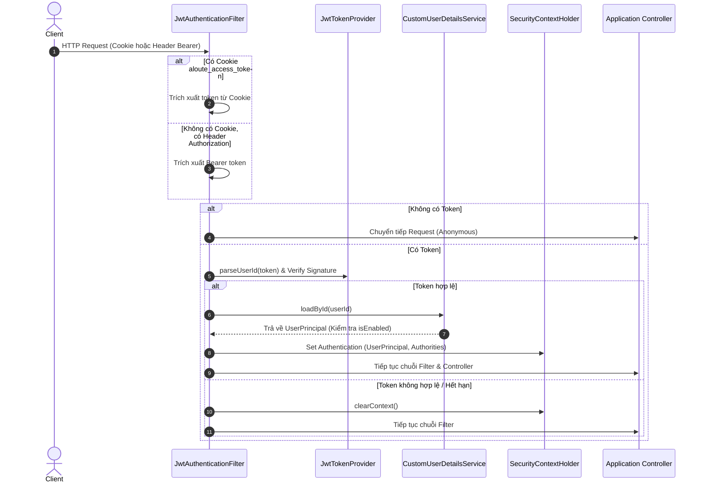

# ALOUTE — TÀI LIỆU ĐẶC TẢ NGHIỆP VỤ AUTHENTICATION & AUTHORIZATION THEO CÁC PHASE

> **Căn cứ tài liệu chuẩn (Source of Truth):**
> - Quy tắc Spring Security: [`skills/author_rule.md`](file:///c:/Users/LENOVO/OneDrive/Videos/aloute/skills/author_rule.md)
> - Quy tắc Nghiệp vụ Domain: [`skills/domain_system.md`](file:///c:/Users/LENOVO/OneDrive/Videos/aloute/skills/domain_system.md)
> - Kiến trúc hệ thống & ErrorCode: [`skills/system_architecture.md`](file:///c:/Users/LENOVO/OneDrive/Videos/aloute/skills/system_architecture.md)
> - Hợp đồng API: [`skills/aloute-openapi.yaml`](file:///c:/Users/LENOVO/OneDrive/Videos/aloute/skills/aloute-openapi.yaml)
> - Thành viên phụ trách Module Auth/Security: **Nguyễn Đoàn Minh Khôi (24110259)**

---

## MỤC LỤC TỔNG QUAN CÁC PHASE

```text
ALOUTE AUTHEN & AUTHOR PIPELINE
│
├── PHASE 1: Khởi tạo Định danh & Quản lý Trạng thái Tài khoản (Identity & Account State)
├── PHASE 2: Xác thực Đăng nhập & Vận chuyển Thông danh tính (Authentication & Token Transport)
├── PHASE 3: Đánh chặn Request & Dựng Ngữ cảnh Bảo mật (Filter Chain & SecurityContext)
├── PHASE 4: Phân quyền Toàn cục & Bảo vệ Tuyến đường (Global Authorization & Route Guards)
├── PHASE 5: Phân quyền Ngữ cảnh Tài nguyên & Nghiệp vụ (Resource-Level & Domain Authorization)
├── PHASE 6: Xác thực & Kiểm soát Kênh Thời gian thực (Realtime & WebSocket STOMP Security)
└── PHASE 7: Quản trị Cấp cao, Kiểm duyệt & Nhật ký An toàn (Admin, Moderation & Audit)
```

---

## PHASE 1: KHỞI TẠO ĐỊNH DANH & QUẢN LÝ TRẠNG THÁI TÀI KHOẢN (IDENTITY & ACCOUNT STATE)

Giai đoạn thiết lập danh tính ban đầu, chuẩn hóa thông tin người dùng và áp đặt các ràng buộc dữ liệu.

### 1.1. Nghiệp vụ Đăng ký (User Registration)
- **Điểm tiếp nhận:** `POST /api/auth/register` (hoặc form Web `/register`).
- **Dữ liệu đầu vào:** `username`, `email`, `password`.
- **Quy tắc kiểm tra & Bất biến nghiệp vụ (Invariants):**
  1. **Username:**
     - Chiều dài từ 3 đến 50 ký tự, chỉ chứa chữ cái, số, dấu gạch dưới (`_`) hoặc dấu chấm (`.`).
     - Bắt buộc kiểm tra tính duy nhất không phân biệt hoa thường (`existsByUsernameIgnoreCase`). Nếu trùng: trả lỗi `HTTP 409 CONFLICT` với mã `USER_USERNAME_ALREADY_EXISTS`.
  2. **Email:**
     - Phải đúng định dạng chuẩn RFC 5322, tối đa 254 ký tự.
     - Luôn được chuẩn hóa: `trim().toLowerCase()`.
     - Bắt buộc kiểm tra tính duy nhất (`existsByEmailIgnoreCase`). Nếu trùng: trả lỗi `HTTP 409 CONFLICT` với mã `USER_EMAIL_ALREADY_EXISTS`.
  3. **Mật khẩu (Password Security):**
     - Mật khẩu tối thiểu 8 ký tự, khuyến nghị có chữ hoa, chữ thường, số.
     - **BẮT BUỘC BĂM (HASH):** Sử dụng `BCryptPasswordEncoder` với salt tự động. Tuyệt đối không lưu mật khẩu dạng plaintext.
  4. **Tạo thực thể liên đới:**
     - Tạo bản ghi [`User`](file:///c:/Users/LENOVO/OneDrive/Videos/aloute/current/src/main/java/com/aloute/entity/User.java) với:
       - `role = Role.USER` (Mặc định).
       - `isActive = true`.
       - `isVerified = false`.
       - `isPrivate = false`.
     - Tự động khởi tạo bản ghi [`Profile`](file:///c:/Users/LENOVO/OneDrive/Videos/aloute/current/src/main/java/com/aloute/entity/Profile.java) tương ứng (`user_id` làm khóa chính) với `displayName = username` và các bộ đếm ban đầu bằng 0.

### 1.2. Vòng đời Trạng thái Tài khoản (Account States)
- `isActive` (`boolean`): Nếu chuyển sang `false` (bị vô hiệu hóa hoặc đình chỉ), người dùng bị chặn ngay lập tức ở cả tầng đăng nhập lẫn tầng kiểm tra token mỗi request (`UserPrincipal.isEnabled() == false`).
- `isVerified` (`boolean`): Tích xanh xác thực hồ sơ. **Lưu ý:** Đây chỉ là trạng thái hiển thị của Profile, tuyệt đối không được dùng làm căn cứ cấp quyền quản trị hay vượt quyền bảo mật.
- `isPrivate` (`boolean`): Chế độ tài khoản riêng tư, quyết định luồng xem bài viết và follow ở Phase 5.

---

## PHASE 2: XÁC THỰC ĐĂNG NHẬP & VẬN CHUYỂN THÔNG DANH TÍNH (AUTHENTICATION & TOKEN TRANSPORT)

Giai đoạn đối chiếu thông tin xác thực, sinh vé xác thực (JWT) và bảo vệ kênh truyền thông giữa Client và Server.

### 2.1. Nghiệp vụ Xác thực Đăng nhập (Authentication Workflow)
- **Điểm tiếp nhận:** `POST /api/auth/login` (hoặc form Web `/login`).
- **Luồng xử lý:**
  1. Client gửi `email` + `password`.
  2. Controller chuyển sang `AuthService.login()`, đóng gói thành `UsernamePasswordAuthenticationToken(email, password)`.
  3. `AuthenticationManager` kích hoạt `DaoAuthenticationProvider` phối hợp cùng [`CustomUserDetailsService`](file:///c:/Users/LENOVO/OneDrive/Videos/aloute/current/src/main/java/com/aloute/security/principal/CustomUserDetailsService.java):
     - Truy vấn User theo Email. Nếu không thấy hoặc tài khoản `isActive == false` → Ném `BadCredentialsException` / `DisabledException`.
     - Đối chiếu mật khẩu bằng `BCryptPasswordEncoder.matches()`.
  4. **Quy tắc an toàn (Security Invariant):**
     - Khi sai email hoặc sai mật khẩu, hệ thống **luôn trả về cùng một thông điệp chung** `HTTP 401 UNAUTHORIZED` với `ErrorCode: AUTH_INVALID_CREDENTIALS` ("Invalid email or password"). Không phân biệt "email không tồn tại" hay "sai mật khẩu" để chống tấn công dò quét tài khoản (Username Enumeration).

### 2.2. Sinh JWT Token (Token Generation)
Sau khi xác thực thành công, [`JwtTokenProvider`](file:///c:/Users/LENOVO/OneDrive/Videos/aloute/current/src/main/java/com/aloute/security/jwt/JwtTokenProvider.java) phát hành JWT:
- **Thuật toán ký:** HMAC-SHA256 với Secret Key tối thiểu 32 bytes (256-bit).
- **Cấu trúc Payload (Claims):**
  - `sub`: ID của người dùng (`userId.toString()`).
  - `roles`: Mảng danh sách Global Role (ví dụ: `["USER"]` hoặc `["SYSTEM_ADMIN"]`).
  - `authorities`: Mảng quyền kỹ thuật nếu là Admin (ví dụ: `["REPORT_REVIEW", "USER_SUSPEND"]`).
  - `iat` (Issued At) và `exp` (Expiration): Thời gian phát hành và hết hạn (mặc định 3600s dev, 86400s prod).
- **Quy tắc vàng (Golden Rule):** Không đưa dữ liệu động (danh sách Community tham gia, quyền hạn trong từng nhóm, trạng thái follow...) vào JWT vì sẽ gây lỗi thông tin cũ (stale claims) khi quyền trong DB thay đổi.

### 2.3. Cơ chế Truyền Nhận Kép (Dual-Transport Strategy)
ALOUTE hỗ trợ cả giao diện Server-Side Rendering (Thymeleaf) và REST API (SPA / Postman / Mobile):
1. **Dành cho Web Thymeleaf (Browser):**
   - JWT được đặt vào **HttpOnly Cookie** mang tên `aloute_access_token`.
   - Thuộc tính Cookie bắt buộc:
     - `HttpOnly = true`: Ngăn chặn hoàn toàn JavaScript phía Client đọc token → Triệt tiêu rủi ro đánh cắp token qua tấn công XSS.
     - `SameSite = Lax`: Chống tấn công giả mạo yêu cầu (CSRF).
     - `Secure = true` (khi chạy HTTPS / Production): Chỉ truyền qua kênh mã hóa TLS.
     - `Path = /`: Có hiệu lực trên toàn bộ domain.
2. **Dành cho REST API Clients / Postman / Mobile:**
   - JWT được gửi qua Header tiêu chuẩn: `Authorization: Bearer <token>`.

### 2.4. Cơ chế Bảo vệ Chống Giả mạo (CSRF Protection)
- Sử dụng mô hình **Double Submit Cookie** qua `CookieCsrfTokenRepository.withHttpOnlyFalse()` và [`CsrfCookieFilter`](file:///c:/Users/LENOVO/OneDrive/Videos/aloute/current/src/main/java/com/aloute/security/config/CsrfCookieFilter.java).
- Client nhận cookie `XSRF-TOKEN` và phải gửi lại trong Header `X-XSRF-TOKEN` đối với toàn bộ yêu cầu làm thay đổi dữ liệu (`POST`, `PUT`, `PATCH`, `DELETE`) khi thực hiện từ Cookie.
- Yêu cầu dùng `Authorization: Bearer` được cấu hình bỏ qua kiểm tra CSRF tự động vì bản chất Token Bearer không bị trình duyệt tự động gửi ngầm.

### 2.5. Nghiệp vụ Đăng xuất (Logout)
- **Điểm tiếp nhận:** `POST /api/auth/logout`.
- Xóa bỏ phiên đăng nhập bằng cách ghi đè Cookie `aloute_access_token` với `maxAge = 0`, giá trị rỗng và xóa ngữ cảnh trong `SecurityContextHolder`.

---

## PHASE 3: ĐÁNH CHẶN REQUEST & DỰNG NGỮ CẢNH BẢO MẬT (FILTER CHAIN & SECURITY CONTEXT)

Giai đoạn tiền xử lý mỗi HTTP request trước khi chạm tới Controller.



### 3.1. Trật tự Trích xuất Token trong [`JwtAuthenticationFilter`](file:///c:/Users/LENOVO/OneDrive/Videos/aloute/current/src/main/java/com/aloute/security/jwt/JwtAuthenticationFilter.java)
- **Bước 1:** Đọc từ Cookie có tên `aloute_access_token`.
- **Bước 2:** Nếu Cookie không tồn tại hoặc rỗng, đọc từ Header `Authorization` bắt đầu bằng tiền tố `"Bearer "`.
- **Bước 3:** Nếu có Token, kiểm tra tính toàn vẹn chữ ký và hạn dùng.
- **Bước 4 (DB Check):** Gọi `CustomUserDetailsService.loadById(userId)`. Bước này đảm bảo nếu tài khoản vừa bị khóa (`isActive = false`) trong cơ sở dữ liệu thì phiên làm việc sẽ bị từ chối ngay lập tức, không phụ thuộc vào hạn dùng của token.

### 3.2. Thiết lập `UserPrincipal` & `SecurityContext`
- Sau khi xác thực, một đối tượng [`UserPrincipal`](file:///c:/Users/LENOVO/OneDrive/Videos/aloute/current/src/main/java/com/aloute/security/principal/UserPrincipal.java) hoàn chỉnh được gắn vào `SecurityContextHolder.getContext().setAuthentication(auth)`.
- `UserPrincipal` triển khai `UserDetails`, nắm giữ:
  - `id`: Mã định danh người dùng.
  - `email`: Tên đăng nhập chính thức.
  - `role`: Global Role (`USER` hoặc `SYSTEM_ADMIN`).
  - `authorities`: Tập quyền Spring Security (ví dụ: `ROLE_USER`, `ROLE_SYSTEM_ADMIN`, `REPORT_REVIEW`, `USER_SUSPEND`).

### 3.3. Trừu tượng hóa Định danh: [`CurrentUserProvider`](file:///c:/Users/LENOVO/OneDrive/Videos/aloute/current/src/main/java/com/aloute/security/currentuser/CurrentUserProvider.java)
- Toàn bộ Controller và Service **tuyệt đối không được tự giải mã JWT** hoặc lấy `userId` truyền lên từ Client.
- Bắt buộc gọi qua `CurrentUserProvider`:
  - `requireUserId()`: Trả về ID của user hiện tại, tự động ném ngoại lệ `HTTP 401 UNAUTHORIZED` nếu chưa đăng nhập.
  - `requirePrincipal()`: Lấy đối tượng `UserPrincipal` của người thực hiện.
  - `getCurrentUserId()`: Trả về `Optional<Long>` (phục vụ các endpoint cho phép cả khách và người dùng đăng nhập như xem Feed).

---

## PHASE 4: PHÂN QUYỀN TOÀN CỤC & BẢO VỆ TUYẾN ĐƯỜNG (GLOBAL AUTHORIZATION & ROUTE GUARDS)

Giai đoạn quyết định Request có được phép đi vào hệ thống hay không dựa trên URL, Phương thức HTTP và Vai trò toàn cục (Global Role).

### 4.1. Nguyên tắc Bất biến: "Deny by Default" (Chặn mặc định)
Mọi tài nguyên không được khai báo rõ ràng trong danh sách trắng (Whitelist) đều bị chặn và bắt buộc phải đăng nhập thành công (`.anyRequest().authenticated()`).

### 4.2. Phân loại Tuyến đường trong [`SecurityConfig`](file:///c:/Users/LENOVO/OneDrive/Videos/aloute/current/src/main/java/com/aloute/security/config/SecurityConfig.java)
1. **Public Routes (Không cần đăng nhập):**
   - Đăng ký, đăng nhập: `/api/auth/register`, `/api/auth/login`.
   - Xem nội dung công khai (chỉ đọc `GET`): `/api/posts`, `/api/posts/*`, `/api/topics/**`, `/api/communities/**`, `/api/users/*`.
   - Static resources: `/css/**`, `/js/**`, `/images/**`, `/favicon.ico`.
   - Khám phá Web: `/`, `/explore`, `/login`, `/register`.
2. **Authenticated Routes (Người dùng đã đăng nhập):**
   - Tạo bài viết, thích, bình luận: `POST /api/posts/**`, `PUT /api/posts/*/likes/me`.
   - Mạng xã hội: `PUT /api/social/follows/*`, `POST /api/reports`.
   - Tin nhắn, thông báo: `/api/conversations/**`, `/api/notifications/**`.
   - Quản lý cá nhân: `PATCH /api/users/me/profile`.
3. **Admin Routes (Dành riêng cho Quản trị viên hệ thống):**
   - Route Web SSR: `/admin/**` → Yêu cầu `hasRole('SYSTEM_ADMIN')`.
   - Route REST API: `/api/admin/**` → Yêu cầu `hasRole('SYSTEM_ADMIN')`.

### 4.3. Xử lý Thất bại Đồng nhất (Error Translation)
Khi vi phạm bảo mật, hệ thống không trả về trang lỗi mặc định của Spring mà đóng gói thành `ApiResponse<T>` theo chuẩn kiến trúc:
- **Chưa đăng nhập (401 Unauthorized):** Do [`AuthenticationFailureHandler`](file:///c:/Users/LENOVO/OneDrive/Videos/aloute/current/src/main/java/com/aloute/security/handler/AuthenticationFailureHandler.java) bắt, trả mã `AUTH_UNAUTHORIZED` hoặc `AUTH_TOKEN_EXPIRED`.
- **Không đủ quyền hạn (403 Forbidden):** Do [`AccessDeniedHandler`](file:///c:/Users/LENOVO/OneDrive/Videos/aloute/current/src/main/java/com/aloute/security/handler/AccessDeniedHandler.java) bắt, trả mã `AUTH_FORBIDDEN`.

---

## PHASE 5: PHÂN QUYỀN NGỮ CẢNH TÀI NGUYÊN & NGHIỆP VỤ (RESOURCE-LEVEL & DOMAIN AUTHORIZATION)

Giai đoạn quan trọng nhất: **Spring Security chỉ biết người dùng là ai (Authentication); tầng Service/Policy chịu trách nhiệm quyết định "Ai được làm gì trên tài nguyên nào" (WHO CAN DO WHAT)**.

### 5.1. Kiểm tra Quyền Sở hữu Tài nguyên (Ownership Verification)
- **Quy tắc:** Chỉ chủ sở hữu thực sự mới có quyền sửa đổi hoặc xóa tài nguyên của mình.
- **Cách thức thực thi:**
  1. Service nạp tài nguyên từ Database theo `resourceId`.
  2. Lấy `currentUserId` từ `CurrentUserProvider.requireUserId()`.
  3. So sánh: `if (!resource.getUserId().equals(currentUserId)) throw new ApiException(HttpStatus.FORBIDDEN, "FORBIDDEN", ...);`
- **Ví dụ áp dụng:**
  - Sửa/Xóa Post: Phải là tác giả (`post.user.id == currentUserId`).
  - Xóa/Gắn Media: Phải là chủ tải lên (`media.owner.id == currentUserId`).
  - Cập nhật Profile: Chỉ sửa được profile của chính mình (`me`).

### 5.2. Phân quyền Theo Nhóm & Phạm vi (Scoped Community Roles)
Quyền trong Community không phải là Global Role của Spring Security mà là quyền động theo từng nhóm cụ thể:
- **Ma trận quyền hạn (Permission Matrix):**
  - **OWNER (`communities.owner_id`):** Toàn quyền tối cao; có quyền chuyển nhượng nhóm, giải tán/xóa nhóm hoặc giáng chức Admin.
  - **ADMIN (`community_members.role = 'ADMIN'`):** Quản lý cài đặt nhóm, duyệt thành viên, phân bổ role Moderator.
  - **MODERATOR (`community_members.role = 'MODERATOR'`):** Xóa bài vi phạm trong nhóm, cảnh báo thành viên, không được đổi cài đặt nhóm.
  - **MEMBER (`community_members.role = 'MEMBER'`):** Đăng bài vào nhóm, bình luận, tương tác.
- **Quy tắc bảo mật nhóm kín (`is_private = true`):**
  - Bài viết trong nhóm kín tuyệt đối không hiển thị ra Home Feed của người ngoài nhóm.
  - Khi xem chi tiết hoặc danh sách bài của nhóm kín, Service bắt buộc kiểm tra sự tồn tại trong bảng `community_members`:
    ```sql
    EXISTS (SELECT 1 FROM community_members WHERE community_id = :cId AND user_id = :currentUserId)
    ```

### 5.3. Quyền Riêng tư & Tương tác Xã hội (Social Safety Invariants)
- **Chặn (Block Invariant):**
  - Nếu User A đã Block User B (hoặc B Block A), mối quan hệ 2 chiều bị vô hiệu hóa:
    - B không thể xem Profile, bài viết của A.
    - B không thể Reply, Quote, Like bài của A.
    - B không thể gửi tin nhắn trực tiếp cho A.
- **Tắt tiếng (Mute Invariant):**
  - Ẩn bài viết và thông báo của người bị Mute khỏi giao diện người dùng, nhưng không ngăn người đó tương tác.
- **Chế độ hiển thị bài viết (`PostVisibility`):**
  - `PUBLIC`: Mọi người đều xem được.
  - `FOLLOWERS`: Chỉ người có quan hệ trong bảng `follows` (`follower_id = currentUserId AND following_id = author_id`) mới được xem.
  - `MENTIONED`: Chỉ những người dùng được gắn thẻ `@username` trong nội dung mới có quyền xem.
- **Giới hạn phản hồi (`allow_reply`, `allow_quote`):**
  - Tác giả bài viết có thể tắt tính năng trả lời hoặc trích dẫn. Service phải kiểm tra trường này trước khi cho phép tạo bài con.

### 5.4. Quyền Hội thoại & Nhắn tin (Conversation Authorization)
- Chỉ những User có bản ghi hợp lệ trong `conversation_members` mới được:
  - Truy vấn lịch sử tin nhắn của cuộc trò chuyện.
  - Gửi tin nhắn mới hoặc gửi tệp đính kèm.
- Nghiêm cấm việc User gửi `conversationId` tùy ý để đọc lén tin nhắn của người khác.

---

## PHASE 6: XÁC THỰC & KIỂM SOÁT KÊNH THỜI GIAN THỰC (REALTIME & WEBSOCKET STOMP SECURITY)

Giai đoạn bảo vệ luồng giao tiếp thời gian thực (Chat, Thông báo tức thời).

### 6.1. Xác thực Kết nối Ban đầu (WebSocket Handshake Authentication)
- Điểm kết nối: `/ws`.
- Khi client gửi yêu cầu nâng cấp kết nối (HTTP Upgrade lên WebSocket), Handshake Interceptor đọc JWT từ HttpOnly Cookie hoặc Query Parameter để xác thực người dùng.
- Gắn danh tính `Principal` đã xác thực vào phiên làm việc của WebSocket Session.

### 6.2. Kiểm soát Quyền Lắng nghe (Subscription Authorization)
Khi client gửi khung tin STOMP `SUBSCRIBE`:
1. **Kênh thông báo cá nhân (`/user/queue/notifications`):**
   - Chỉ chính User sở hữu phiên kết nối mới được phép lắng nghe kênh riêng của mình.
2. **Kênh phòng chat (`/topic/conversation.{conversationId}`):**
   - STOMP Channel Interceptor trích xuất `conversationId` từ destination.
   - Truy vấn CSDL kiểm tra xem `currentUserId` có phải là thành viên trong `conversation_members` hay không. Nếu không: Từ chối yêu cầu lắng nghe (Reject Subscription).

### 6.3. Kiểm soát Quyền Gửi Dữ liệu (Message Send Authorization)
Khi client gửi khung tin STOMP `SEND` tới `/app/chat.send.{conversationId}`:
- Bắt buộc kiểm tra `currentUserId` là thành viên hợp lệ.
- Áp dụng nguyên tắc **Persist-before-publish**: Tin nhắn bắt buộc phải được kiểm tra quyền, lưu thành công vào CSDL quan hệ trước khi bắn sự kiện realtime tới các thành viên khác.

---

## PHASE 7: QUẢN TRỊ CẤP CAO, KIỂM DUYỆT & NHẬT KÝ AN TOÀN (ADMIN, MODERATION & AUDIT)

Giai đoạn quản trị hệ thống và kiểm duyệt nội dung vi phạm.

### 7.1. Phân quyền Quản trị Toàn cục (System Admin Authorities)
Người dùng có `global_role = 'SYSTEM_ADMIN'` được nạp 2 quyền kỹ thuật đặc biệt:
1. `GlobalAuthority.REPORT_REVIEW`:
   - Quyền truy cập Dashboard quản trị (`/admin/reports`).
   - Xem chi tiết các báo cáo vi phạm bài viết hoặc người dùng.
   - Đưa ra phán quyết: Bỏ qua (Dismiss) hoặc Xử phạt (Take Action).
2. `GlobalAuthority.USER_SUSPEND`:
   - Quyền đình chỉ tài khoản người dùng (`isActive = false`).
   - Cấm đăng bài hoặc giới hạn tính năng toàn hệ thống.

### 7.2. Ghi vết Kiểm duyệt (Audit Trail & Moderation Log)
- Mọi thao tác gỡ bài, khóa người dùng hoặc giải quyết báo cáo bắt buộc phải ghi vào bảng [`ModerationAction`](file:///c:/Users/LENOVO/OneDrive/Videos/aloute/current/src/main/java/com/aloute/entity/ModerationAction.java).
- Dữ liệu ghi vết bao gồm:
  - `actor_id`: ID của Admin thực hiện (lấy từ `CurrentUserProvider.requireUserId()`, tuyệt đối không lấy từ form).
  - `target_type`: Loại đối tượng (`POST`, `USER`, `COMMUNITY`).
  - `target_id`: ID của đối tượng bị xử lý.
  - `action`: Hành động (`REMOVED`, `SUSPENDED`, `WARNED`).
  - `reason`: Lý do xử lý vi phạm.
  - `created_at`: Thời điểm thực thi.

---

## BẢNG TỔNG HỢP TRÁCH NHIỆM GIỮA CÁC TẦNG BẢO MẬT

| Nghiệp vụ / Hành vi | Tầng phụ trách | Thành phần code / File đảm nhiệm | Mã lỗi trả về |
| :--- | :--- | :--- | :--- |
| **Đăng ký / Kiểm tra trùng lặp** | Service | `AuthServiceImpl.register()` | `409 CONFLICT`<br>`USER_USERNAME_ALREADY_EXISTS` |
| **Băm & Khớp mật khẩu** | Security Provider | `BCryptPasswordEncoder`, `DaoAuthenticationProvider` | `401 UNAUTHORIZED`<br>`AUTH_INVALID_CREDENTIALS` |
| **Trích xuất & Kiểm tra JWT** | Security Filter | `JwtAuthenticationFilter`, `JwtTokenProvider` | `401 UNAUTHORIZED`<br>`AUTH_UNAUTHORIZED` |
| **Bảo vệ CSRF** | Security Filter | `CsrfCookieFilter`, `SecurityConfig` | `403 FORBIDDEN` |
| **Chặn route Admin `/admin/**`** | URL Authorization | `SecurityConfig.securityFilterChain()` | `403 FORBIDDEN`<br>`AUTH_FORBIDDEN` |
| **Sửa / Xóa bài viết cá nhân** | Domain Policy / Service | `PostServiceImpl`, `CurrentUserProvider` | `403 FORBIDDEN`<br>`POST_NOT_FOUND_OR_FORBIDDEN` |
| **Quyền Admin/Mod trong Community**| Domain Policy / Service | `CommunityServiceImpl`, `community_members` | `403 FORBIDDEN`<br>`COMMUNITY_OWNER_REQUIRED` |
| **Xem bài viết Nhóm kín** | Domain Query / Service | `FeedServiceImpl`, `PostRepository` | Tự động loại trừ khỏi kết quả |
| **Lắng nghe phòng chat STOMP** | WebSocket Interceptor | WebSocket Channel Interceptor | Ngắt kết nối / Reject STOMP frame |
| **Kiểm duyệt báo cáo & Khóa User** | Method Security / Admin | `@PreAuthorize("hasRole('SYSTEM_ADMIN')")`, `AdminController` | `403 FORBIDDEN`<br>`AUTH_FORBIDDEN` |

---
*Tài liệu được biên soạn phục vụ đồ án ALOUTE — Bám sát kiến trúc phần mềm, bảo mật Spring Security và quy định phân công trách nhiệm nhóm 13.*
