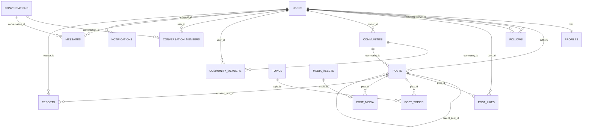
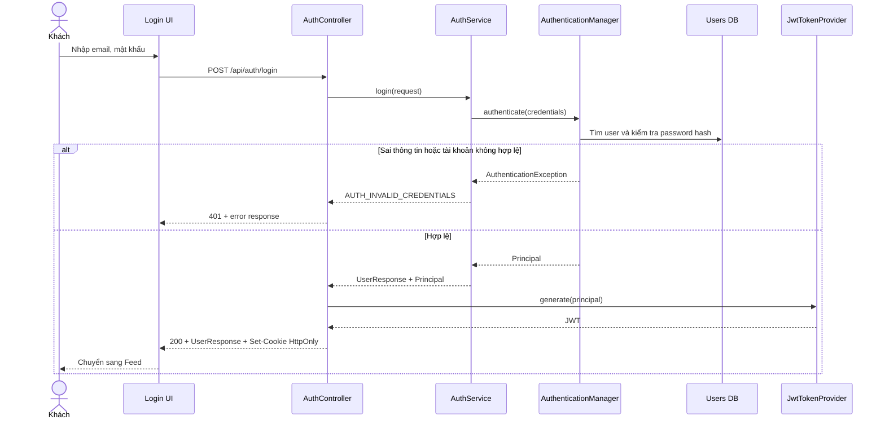
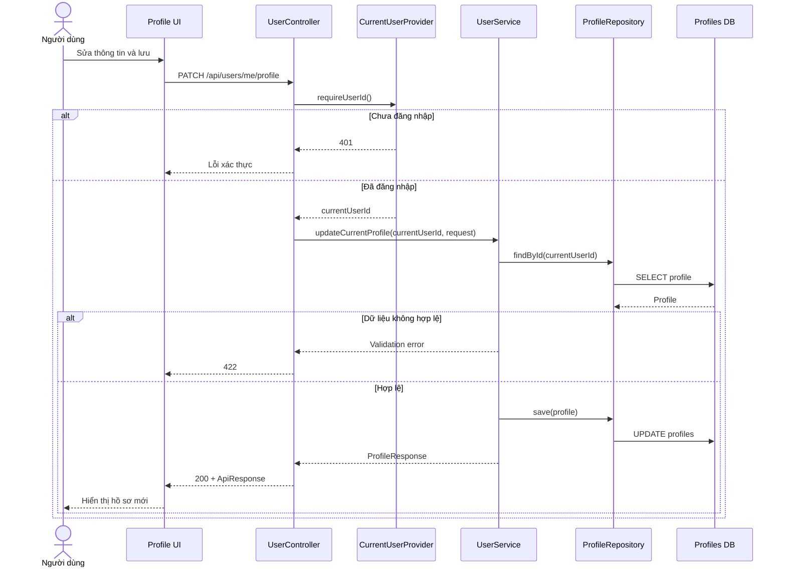
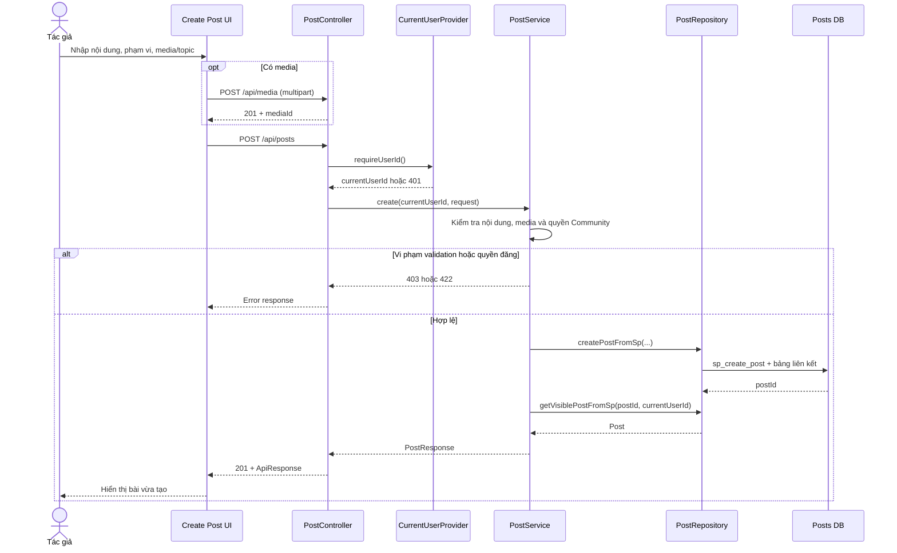
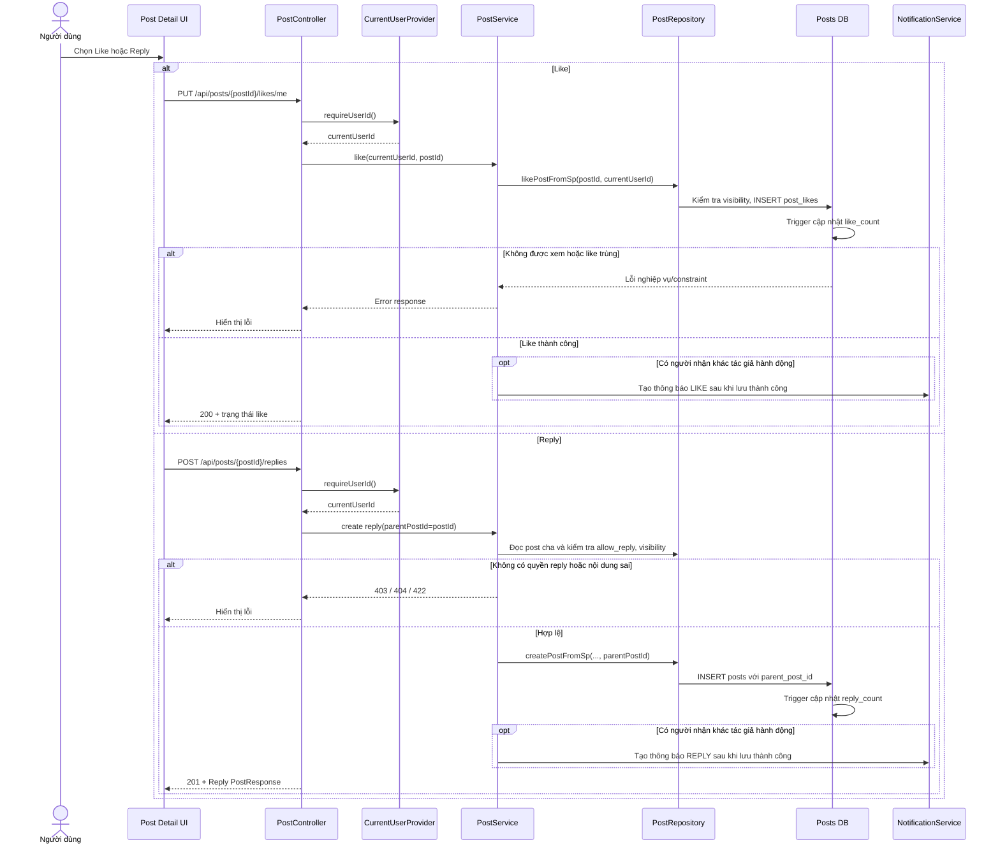
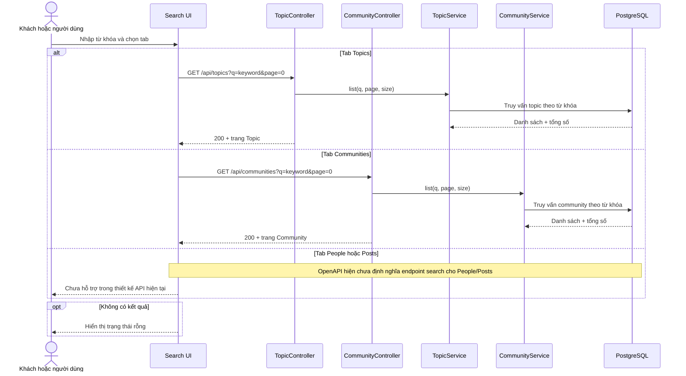
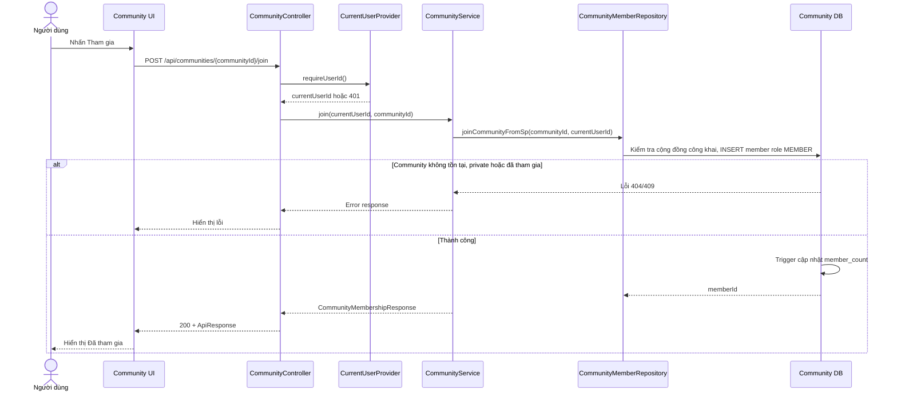
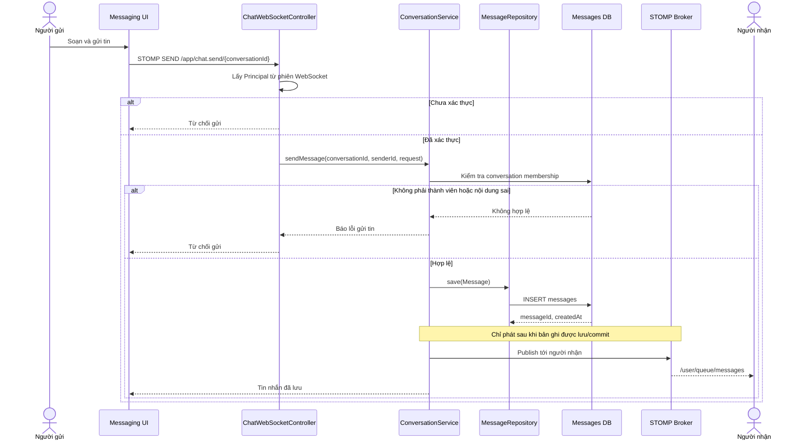
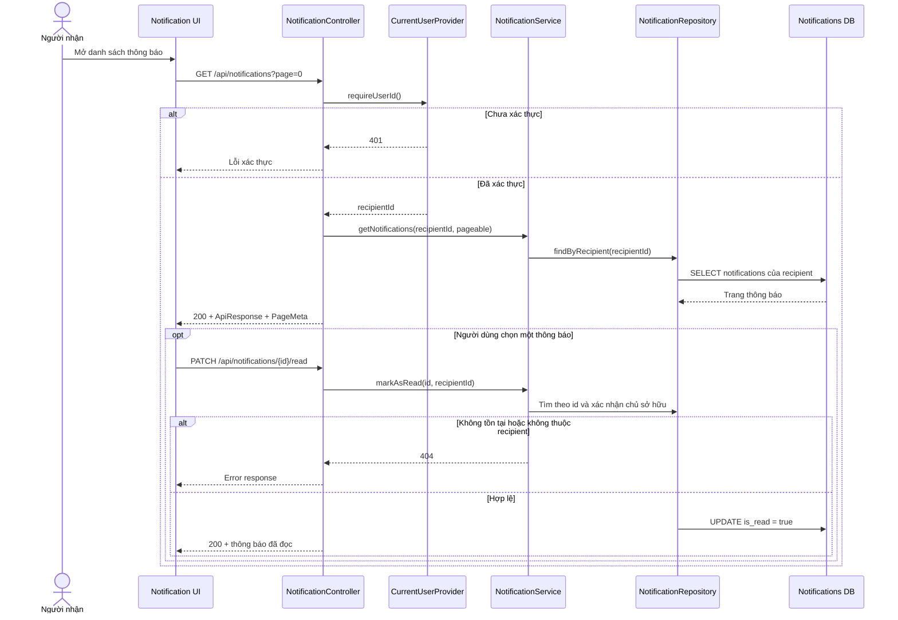
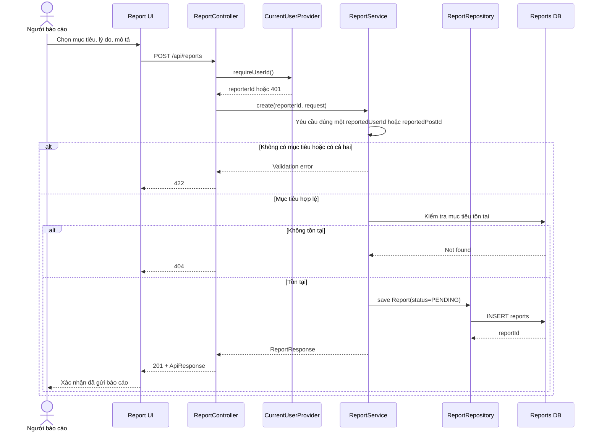

# BÁO CÁO THIẾT KẾ HỆ THỐNG ALOUTE

**Phạm vi:** Thiết kế giao diện, thiết kế dữ liệu và thiết kế xử lý (10 lược đồ tuần tự).

**Nhóm 13:** Bằng (use case, messaging), Khôi (auth, profile, social), Ngọc (DB, post, community), Quân (UI).
**Căn cứ:** `skills/INDEX.md`, `skills/domain_system.md`, `skills/system_architecture.md`, `skills/aloute-openapi.yaml`, `skills/backend_rule.md`, `skills/author_rule.md`, `SCREEN_FLOW.md` và các nhánh `origin/master`, `origin/feat/bang-week3`, `origin/week2_3_khoi`, `origin/ngoc-dev`, các nhánh giao diện của Quân (đối chiếu ngày 08/10/2026).

> Đây là tài liệu thiết kế để nộp và thuyết trình, không phải biên bản nghiệm thu chức năng chạy được. Khi tài liệu này tóm tắt khác tài liệu canonical, quy tắc ở `skills/` là nguồn quyết định.

## 1. Thiết kế giao diện

Giao diện chính dùng Thymeleaf và Bootstrap. Người dùng đi từ đăng nhập/đăng ký vào Feed, mở bài viết hoặc hồ sơ, rồi chuyển sang tìm kiếm, Community, nhắn tin và thông báo. Bộ [10 wireframe SVG](ui/wireframes/README.md) mô tả đầy đủ các màn hình này; [SCREEN_FLOW.md](../SCREEN_FLOW.md) ghi luồng điều hướng.

| Nhóm màn hình | Hình thiết kế | Tác vụ chính |
|---|---|---|
| Xác thực | [Đăng nhập](ui/wireframes/01-login.svg), [đăng ký](ui/wireframes/02-register.svg) | Nhập thông tin, báo lỗi, chuyển vào Feed |
| Nội dung | [Feed](ui/wireframes/03-home-feed.svg), [tạo bài](ui/wireframes/05-create-post.svg), [chi tiết bài](ui/wireframes/06-post-detail.svg) | Xem, tạo, like, reply và báo cáo bài |
| Cá nhân | [Hồ sơ](ui/wireframes/04-profile.svg) | Xem/sửa hồ sơ, follow/unfollow |
| Khám phá | [Tìm kiếm](ui/wireframes/07-search.svg), [Community](ui/wireframes/08-community.svg) | Tìm đối tượng, xem và tham gia cộng đồng |
| Giao tiếp | [Tin nhắn](ui/wireframes/09-messaging.svg), [thông báo](ui/wireframes/10-notification.svg) | Gửi/nhận tin, xem và đánh dấu thông báo |

Trên desktop, thiết kế Feed dùng ba vùng: điều hướng/hồ sơ, nội dung chính và thông tin cộng đồng/chủ đề. Trên màn hình hẹp, nội dung chính ưu tiên một cột. Trạng thái lỗi, rỗng và đang tải được thể hiện trong wireframe; quyền thao tác vẫn phải được kiểm tra ở backend.

## 2. Thiết kế dữ liệu

Hệ thống dùng CSDL quan hệ; môi trường triển khai chính là PostgreSQL. `users` là gốc cho danh tính, `profiles` lưu thông tin hiển thị; `posts` là gốc cho bài viết và reply; `communities` là gốc cho cộng đồng. Các quan hệ N-N được tách thành bảng trung gian, và bài trả lời dùng khóa ngoại tự tham chiếu. Sơ đồ dưới đây rút gọn các bảng liên quan trực tiếp đến 10 use case; mô hình đầy đủ nằm trong [domain_system.md](../skills/domain_system.md).



| Bảng/quan hệ | PK và FK trọng tâm | Ràng buộc chính |
|---|---|---|
| `users`, `profiles` | `users.id`; `profiles.user_id -> users.id` | Username/email duy nhất; mỗi user có một profile |
| `posts` | `id`; `user_id -> users.id`; `parent_post_id -> posts.id`; `community_id -> communities.id` | Reply là post tự tham chiếu; `deleted_at` phục vụ soft delete; kiểm soát visibility khi đọc |
| `post_likes` | `id`; `user_id -> users.id`; `post_id -> posts.id` | `UNIQUE(user_id, post_id)` chống like trùng |
| `follows` | cặp `follower_id`, `following_id` -> `users.id` | Một quan hệ follow cho mỗi cặp có hướng |
| `communities`, `community_members` | `communities.owner_id -> users.id`; `community_members.community_id -> communities.id`, `user_id -> users.id` | `UNIQUE(community_id, user_id)`; owner lấy từ `owner_id`, không suy từ role |
| `post_topics`, `post_media` | FK tới post và topic/media | Bảng nối N-N cho topic; mỗi media gắn tối đa một post theo schema hiện tại |
| `conversations`, `conversation_members`, `messages` | Message tham chiếu conversation và sender | Chỉ thành viên hợp lệ được gửi/xem tin nhắn |
| `notifications`, `reports` | FK tới user nhận thông báo/người báo cáo | Truy vấn thông báo theo người nhận; report nhắm một user hoặc một post |

Phần SQL thuộc Ngọc nằm ở [schema.sql](../src/main/resources/db/schema.sql), [triggers.sql](../src/main/resources/db/triggers.sql), [procedures.sql](../src/main/resources/db/procedures.sql) và [data-seed.sql](../src/main/resources/db/data-seed.sql). Index trên bài viết, follow, thành viên, thông báo và tin nhắn hỗ trợ truy vấn theo khóa và thời gian. Trigger đồng bộ bộ đếm; stored function/procedure hỗ trợ thao tác nội dung và cộng đồng. Nhánh hiện tại chưa có một migration thống nhất cho toàn bộ bảng của các thành viên, nên sơ đồ rút gọn ở trên là thiết kế liên module, không khẳng định một lần chạy `schema.sql` tạo được tất cả bảng.

## 3. Thiết kế xử lý

### 3.1. Kiến trúc và quy ước đọc sơ đồ

Luồng HTTP đi qua `UI -> Controller -> Service -> Repository -> PostgreSQL`. Spring Security/JWT xác thực; Controller lấy user ID từ Principal; Service kiểm tra quyền trên tài nguyên và quản lý transaction; Repository truy cập CSDL. API trả `ApiResponse<T>` theo [system_architecture.md](../skills/system_architecture.md). Media nhị phân đi qua backend tới Firebase Storage, còn metadata lưu SQL. Với chat, phải lưu tin nhắn vào SQL trước khi phát sự kiện WebSocket.

Mỗi sơ đồ có nhánh chính và ít nhất một tình huống lỗi/ngoại lệ. `DB` trong sơ đồ là CSDL quan hệ, không phải một service riêng. Các sơ đồ thể hiện thiết kế theo contract hiện hành; nơi code giữa các nhánh chưa hội tụ được ghi tại mục 3.3.

| Số | Use case | API/transport chính | Bảng trọng tâm | Màn hình |
|---|---|---|---|---|
| 1 | Đăng nhập | `POST /api/auth/login` | `users` | Login |
| 2 | Cập nhật hồ sơ | `PATCH /api/users/me/profile` | `profiles` | Profile |
| 3 | Tạo bài viết | `POST /api/posts` | `posts`, `post_media`, `post_topics` | Create Post |
| 4 | Like hoặc Reply | `PUT /api/posts/{postId}/likes/me`, `POST /api/posts/{postId}/replies` | `post_likes`, `posts` | Post Detail |
| 5 | Follow/Unfollow | `PUT/DELETE /api/social/follows/{userId}` | `follows`, `profiles` | Profile |
| 6 | Tìm kiếm | `GET /api/topics?q=...`, `GET /api/communities?q=...`; tìm kiếm tổng hợp chưa có contract | `topics`, `communities`; dự kiến `users`, `posts` | Search |
| 7 | Tham gia Community | `POST /api/communities/{communityId}/join` | `communities`, `community_members` | Community |
| 8 | Gửi tin nhắn | STOMP `/app/chat.send/{conversationId}` | `conversations`, `conversation_members`, `messages` | Messaging |
| 9 | Xem thông báo | `GET /api/notifications`, `PATCH /api/notifications/{id}/read` | `notifications` | Notification |
| 10 | Báo cáo nội dung | `POST /api/reports` | `reports`, `users`, `posts` | Post Detail/Profile |

### 3.2. Mười lược đồ tuần tự

#### SD-01. Đăng nhập



#### SD-02. Cập nhật hồ sơ cá nhân



#### SD-03. Tạo bài viết



#### SD-04. Like hoặc Reply bài viết



#### SD-05. Follow/Unfollow

```mermaid
sequenceDiagram
    actor U as Người theo dõi
    participant UI as Profile UI
    participant C as SocialController
    participant P as CurrentUserProvider
    participant S as SocialService
    participant R as FollowRepository
    participant DB as Follows DB
    U->>UI: Nhấn Follow hoặc Unfollow
    UI->>C: PUT/DELETE /api/social/follows/{userId}
    C->>P: requireUserId()
    P-->>C: currentUserId hoặc 401
    C->>S: follow/unfollow(currentUserId, targetId)
    S->>S: Kiểm tra self-follow, target, block và private gap
    alt Self-follow, private chưa hỗ trợ hoặc quan hệ sai trạng thái
        S-->>C: 404 hoặc 409
        C-->>UI: Error response
    else Hợp lệ
        S->>R: insert/delete Follow
        R->>DB: Ghi quan hệ; cập nhật bộ đếm nhất quán
        DB-->>R: Hoàn tất
        C-->>UI: 200 Follow hoặc 204 Unfollow
        UI-->>U: Cập nhật nút và bộ đếm
    end
```

#### SD-06. Tìm kiếm



#### SD-07. Tham gia Community công khai



#### SD-08. Gửi tin nhắn



#### SD-09. Xem thông báo và đánh dấu đã đọc



#### SD-10. Báo cáo user hoặc bài viết



### 3.3. Đối chiếu thiết kế với các nhánh

- Bằng đã có các sơ đồ nguồn PlantUML cho tạo bài, like, reply, gửi tin và thông báo trên `origin/master` (`docs/bang/sequence/`). Báo cáo này gom Like/Reply thành một use case tương tác để giữ đúng 10 sơ đồ; không thay đổi file do Bằng sở hữu.
- Khôi có code đăng nhập, hồ sơ, follow và báo cáo trên `origin/week2_3_khoi`; API hồ sơ đúng là `PATCH /api/users/me/profile`, không phải `PUT /api/users/{id}` trong ma trận cũ.
- Ngọc có stored function/procedure cho post và community trên `origin/ngoc-dev`. Khi tích hợp với code của các nhánh khác, cần kiểm tra một nơi duy nhất chịu trách nhiệm cập nhật bộ đếm follow/like để tránh cộng hai lần.
- Mã messaging/notification của Bằng đã vào `origin/master`, nhưng chưa được merge vào `ngoc-dev` tại thời điểm viết báo cáo. Sơ đồ SD-08/09 phản ánh contract và thiết kế liên nhánh, không khẳng định đã chạy trên nhánh hiện tại.
- SD-08 mô tả yêu cầu lưu và commit trước khi publish; cần kiểm tra lại thứ tự transaction/event trong mã messaging sau khi merge. SD-10 có bước kiểm tra post tồn tại theo contract, trong khi `ReportServiceImpl` hiện mới giữ `reportedPostId` mà chưa xác minh bản ghi post.
- Search có API lọc Topic và Community; `GET /api/search` trong ma trận cũ **không có** trong OpenAPI. Vì thế SD-06 chỉ mô tả hai tab có contract và nêu rõ khoảng trống People/Posts.
- Private-account follow request và private-community join approval vẫn là gap theo Domain. Sơ đồ không giả định quy trình phê duyệt đã tồn tại.

**Kết quả phần thiết kế xử lý:** 10/10 use case có luồng chính, nhánh lỗi, thành phần tham gia và bảng dữ liệu liên quan. Các sơ đồ Mermaid ở mục 3.2 hiển thị trực tiếp thành hình khi xem file trên GitHub.
